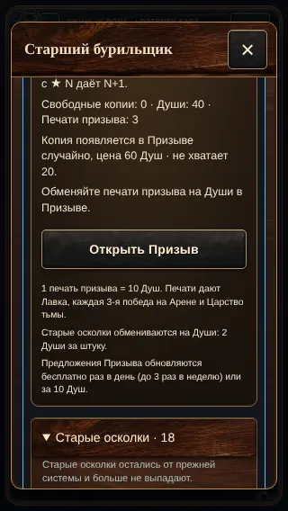
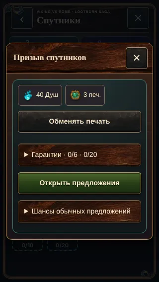

# Звёзды спутников — разбор обратной связи игрока

Жалоба: «Старший бурильщик» (редкий боец, ур. 100, ★ 1). Окно показывает ★ 1/40 и «старые осколки 18/20», предлагает обменять 18 осколков на 36 Душ. Как повысить звезду, непонятно.

## Как устроено сейчас (код `codex-build`)
- **Звёзды.** Звезда растёт при объединении с копией того же спутника: вкладка «Звёзды» → «Объединить с копией» (`followerMerge`). Результат: ★ принимающего + ★ донора + 1. Копия без звёзд даёт +1, копия с ★ 2 даёт +3. Предел — 40 звёзд, каждые две ступени пробуждения добавляют 10.
- **Копии.** Покупаются в «Призыве» за Звёздные души: Добротный 30, Редкий 60, Эпический 180, Легендарный 300. Набор из трёх предложений случайный, обновляется бесплатно раз в день (до 3 раз в неделю) или за 10 Душ.
- **Души.** 1 Печать призыва = 10 Душ. Печати дают Лавка, каждая 3-я победа на Арене (`grantArenaVictory`), Царство тьмы, коллекции и события. 1 старый осколок = 2 Души.
- **Старые осколки.** Остались от прежней системы, где звезду покупали осколками (10/20/40/70/110, до ★ 5). В текущей игре их ничего не выдаёт: в коде нет начисления, есть только расход.

## Найденные ошибки и противоречия
1. **Тупик в интерфейсе (исправлено).** Во вкладке «Звёзды» основной была неактивная кнопка «Звезда 2 · осколки 18/20». Набрать 20 осколков нельзя: они больше не выпадают. Настоящий путь (копия и объединение) не объяснялся. Без копий в каталоге кнопки «Выбрать донора» не было, и игрок не видел, что делать.
2. **Обмен осколков без пояснения, зачем нужны Души (исправлено).**
3. **Предел ★ 1/40 рядом с прежним пределом ★ 5 за осколки.** Это не ошибка: осколки работают только до ★ 5, общий предел 40. Теперь подпись это разделяет.
4. **Доступность по редкостям.** Каждый из 16 спутников всех четырёх существующих редкостей может выпасть в Призыве и получает звезду от копии (тест `tests/companion-stars.test.ts`). Стартовые Гусь и Пёс могут принимать копии, но сами донорами не бывают — так и задумано.
5. **Не исправлялось (нужно решение).** Счётчик «мифической гарантии» в Призыве копится до 20, но мифических спутников в игре нет, и гарантия никогда не срабатывает. Это экономика Призыва, её не трогал.

## Что изменено
Только интерфейс, баланс и данные не тронуты.
- Вкладка «Звёзды» показывает блок «Как получить ★ N»: правило объединения, сколько свободных копий, Душ и Печатей.
  - Если копия есть, кнопка «Объединить с копией».
  - Если копии нет: цена копии и сколько Душ не хватает. Если хватает печатей — совет обменять их. Кнопка «Открыть Призыв», где взять Души и как обновить предложения.
- У предела звёзд — подсказка открыть ступени «Пробуждения».
- «Старые осколки»: пояснение, что они больше не выпадают, и сколько не хватает. Неактивная кнопка убрана. Если осколков хватает, звезду за них по-прежнему можно получить. При обмене сказано, на что тратятся Души.
- Английский перевод всех новых строк.

## Проверки
- `scripts/qa/companion-stars.cjs`, 320/360/390/430 px, добавлен в CI. Старое сохранение (до системы экземпляров) с ур. 100, ★ 1 и 18 осколками:
  - данные сохраняются;
  - подсказка показывает 0 копий, 40 Душ, 3 печати, «не хватает 20» и совет обменять печати;
  - кнопка ведёт в Призыв;
  - после появления копии «Объединить с копией» даёт ★ 2, уровень 100 и 18 осколков не теряются, после перезагрузки всё на месте;
  - горизонтальной прокрутки нет.
- `tests/companion-stars.test.ts`: миграция старого сохранения; каждый вид каждой редкости доступен в Призыве и получает звезду; перевод.
- `npm test`, `npm run lint`, `npx tsc -b`.

 

## Инструкция для игрока
**Как повысить звезду спутника**
1. Откройте «Спутники», выберите спутника, вкладка «Звёзды». Блок «Как получить ★…» показывает, сколько у вас копий, Душ и Печатей призыва.
2. Нужна копия того же спутника. Её можно купить в «Призыве» за Звёздные души. Цена: Добротный 30, Редкий 60, Эпический 180, Легендарный 300.
3. Души: 1 Печать призыва = 10 Душ (обмен в Призыве). Печати дают Лавка, каждая 3-я победа на Арене и Царство тьмы. Старые осколки можно обменять: 1 осколок = 2 Души.
4. Если нужного спутника нет среди трёх предложений, обновите их: бесплатно раз в день или за 10 Душ.
5. Купив копию, вернитесь во вкладку «Звёзды» и нажмите «Объединить с копией». Копия без звёзд даёт +1 звезду, копия со звёздами — больше. Уровень и таланты основного спутника сохраняются, копия расходуется. Спутника в строю или защищённого спутника объединить нельзя.
6. Предел звёзд поднимается ступенями во вкладке «Пробуждение».

**Пример для Старшего бурильщика (★ 1, 18 старых осколков).** Обменяйте 18 осколков на 36 Душ и при необходимости печати на Души, чтобы набрать 60. Когда Бурильщик появится в Призыве, купите его и объедините — будет ★ 2.
