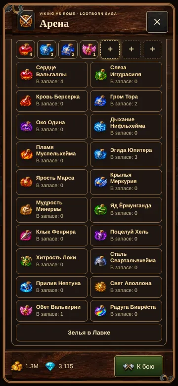
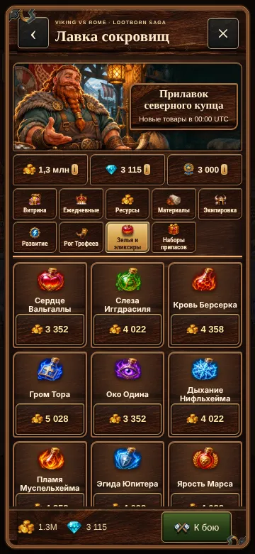

# Расходники Арены V1.0 — реализация и симуляция

Утверждено владельцем 26.11 (Issue #81, комментарий 7186062726). Числа не менялись.

## Что сделано
- **Единый каталог** `src/arena/potion.ts → consumableRules`: 20 строк в порядке владельца (эффект, длительность, индивидуальный откат, множитель цены). ID `potion` (Сердце Вальгаллы) и магазинный `arena-potion` сохранены; 45 % / 4 с по-прежнему берутся из `config/test-balance.v1.json`. Графика — утверждённые `public/art/elixirs/*.webp`.
- **Эффекты в общем движке** (`src/arena/heroCombat.ts`: `applyConsumable`, хуки в `resolveHeroTurn`, `strikeDamage`, `recover`): одинаковы для локального и сетевого боя, 1×1, 3×3 и 20×20.
- **Правила боя** (`server/arena/duel.ts → drinkStatElixir`, проверка на сервере): только виды из закреплённого пояса; до 5 единиц каждого вида за бой (Обет — 1); общий откат 2 с; индивидуальный откат по таблице; предмет, который ничего не сделает (полное HP, нечего снимать, нет цели), не тратится.
- **Лавка** → «Зелья и эликсиры»: 20 предложений за золото, цена = действующая формула Сердца Вальгаллы × множитель (`consumablePrice`). Свободным игрокам доступно, реальных денег нет.
- **Запас**: Сердце — прежнее поле `arenaPotions`; остальные 19 — `arenaConsumables`. Списывается только применённая единица; неиспользованные остаются в запасе.
- **Пояс**: редактор показывает все 20 видов (две колонки), без горизонтальной прокрутки на 360 px.

 

## Как реализованы правила совместимости
| Правило | Реализация |
|---|---|
| Повтор эффекта не суммируется | повтор продлевает срок, значение не растёт; щит Эгиды заменяется, не складывается |
| Кровь Берсерка, Гром Тора, Свет Аполлона не перемножаются | бонусы **складываются**: 1 + 0,35 + 0,6 + 0,3 |
| Гром Тора и Хитрость Локи не на одном ударе | если сработала Локи, Тор не применяется и ждёт следующего удара |
| Горение разных игроков не суммируется | у цели одно горение; новое заменяет текущее |
| Лечение не выше макс. HP; Яд −50 % | все лечения идут через `recover` (потолок, Яд) |
| Вампиризм не от периодики и отражения | Поцелуй Хель — только от прямого урона удара |
| Нептун не воскрешает, получатель раз в 10 с | лечит только живых; у каждого получателя отметка 10 с |
| Обет один раз за бой | в бой берётся 1 единица + флаг срабатывания |

## Технические неоднозначности (решения на согласование, числа не тронуты)
1. **Сетевой PvP.** Доверенный серверный запас есть только для Сердца (W066, зона Codex). Для 19 новых видов сервер **не доверяет** клиентскому числу: в сетевом бою они 0 и отклоняются. Они работают в локальном бою и в серверной проверке локального боя (proof), где клиентский запас принимается так же, как сейчас `localPotions`, но с ограничением «только пояс, не больше 5». Для сетевого PvP нужна выдача по видам в W066 — это контракт Codex, здесь не дублировался.
2. «Не перемножаются» трактуется как **сложение** бонусов. Кровь Берсерка (+35 % атаки) действует на прямые удары героя, не на спутников и горение.
3. Хитрость Локи: полный блок пропускает 50 % удара; пробитый блок (крит/пояс) — 90 % вместо 80 %.
4. Мудрость Минервы снимает самый долгий из действующих отрицательных эффектов: Нифльхейм, Яд, горение Муспельхейма, оглушение, замедления.
5. Обет Валькирии спасает от любого смертельного урона (включая горение); срабатывает раньше перка «Второе дыхание».
6. Гром Тора — любой следующий попавший прямой удар героя, включая навык.
7. Отрицательные эффекты в 3×3/20×20 идут в противника, которого игрок бил последним (иначе — в самого слабого).
8. Цена зависит от этапа игрока (как у Сердца). Будущая торговля должна это учитывать, чтобы не было арбитража между уровнями.

## Симуляция (реальный движок, `npx tsx scripts/sim/consumables.ts`)
Все бойцы на автоударах; сторона «с расходниками» пьёт по политике ручного игрока (лечение ниже 50 % HP, остальное сразу). 1×1 — 40 сидов, 3×3 — 16, 20×20 — 6. Сырые данные: `sim-levels.jsonl`, `sim-combos.jsonl`.

| Уровень | 1×1 без/с (победы) | 3×3 без/с | 20×20 без/с | Длительность p50 1×1 / 3×3 / 20×20 | Расход на бойца за бой, в победах обычного этапа |
|---|---|---|---|---|---|
| 1 | 45 % / 93 % | 75 % / 100 % | 33 % / 83 % | 5,5 / 11 / 20 с | 6,6 / 8,0 / 7,2 |
| 25 | 42 % / 80 % | 44 % / 100 % | 50 % / 100 % | 5,5 / 11 / 20 с | 6,4 / 7,6 / 7,0 |
| 50 | 47 % / 88 % | 56 % / 100 % | 50 % / 100 % | 5,6 / 11 / 23 с | 6,4 / 7,7 / 6,9 |
| 100 | 40 % / 93 % | 56 % / 100 % | 50 % / 100 % | 5,5 / 11 / 20 с | 6,4 / 7,8 / 6,9 |
| 150 | 50 % / 90 % | 44 % / 100 % | 33 % / 100 % | 5,5 / 8 / 20 с | 6,4 / 7,9 / 6,8 |

Неравные бойцы (+7 уровней у противника, предел подбора), расходники только у слабой стороны: на 25–150 ур. она выигрывает 60–90 % в 1×1, 75–100 % в 3×3 и 33–100 % в 20×20. На 1 ур. разрыв 1→8 не перекрывается (0 %). Когда расходники у обеих сторон, 1×1 возвращается к 50–63 %. В 3×3 и 20×20 разброс больше из-за малого числа сидов.

**Непобедимые комбинации.** 6 поясов (нет, только Сердце, атака, защита, выживание, контроль), круговой турнир 1×1 на 25 и 100 ур. Ни один пояс не набирает ≥ 90 % против всех: «выживание» (Сердце, Слеза, Хель, Эгида, Обет, Нептун, Сталь) — 93 % против пустого пояса, но 50 % против «атаки» и 63–65 % против «защиты». Самая долгая пара — «выживание» против «защиты»: p95 17 с, до лимита времени не доходит.

**Сердце Вальгаллы.** 5 применений дают до 225 % HP лечения, но бой 1×1 на авто длится около 5,5 с, а откат Сердца 4 с. Поэтому за бой обычно срабатывает одно Сердце: пояс «только Сердце» даёт +0–2 п.п. к победам и расходует 0,06–0,12 победы этапа. Числа не менялись.

**Выводы для настройки по реальным боям (без изменений сейчас):** бои короче длительности большинства эффектов (10–12 с), поэтому сильнее всего мгновенные и защитные расходники. Полный пояс, выпитый целиком, стоит около 6–8 побед обычного этапа за бой.

## Проверки
- `npm test`: все тесты зелёные, новые в `tests/arena-consumables.test.ts`: таблица, цены, лимиты, откаты, лечение и Яд, Биврёст и Минерва, горение, Эгида и Обет, сложение бонусов и Тор/Локи, Нептун, локальный запас, сетевой PvP без доверия.
- `npm run lint`, `npx tsc -b`: без ошибок.
- UI на 360 px (Playwright): 20 вариантов в редакторе пояса, слот назначается; в Лавке 20 предложений, покупка списывает золото и добавляет 1 единицу; ошибок страницы нет.
